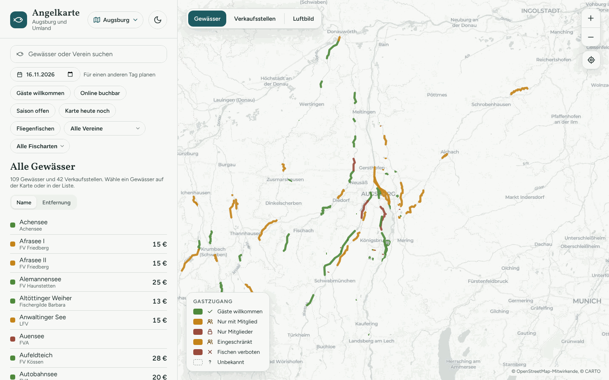

# Angelkarte Augsburg



Interactive map for Augsburg and the surrounding area that shows which angling clubs sell day tickets (Tageskarten), for which waters, and where to buy them.

Built with [Vue 3](https://vuejs.org), TypeScript, [Vite](https://vite.dev) and [Leaflet](https://leafletjs.com) on [CARTO](https://carto.com/basemaps) base maps (OpenStreetMap data). There is no backend. The data lives in plain GeoJSON and JSON files that are fetched at runtime.

## Getting started

Requires Node 22.13+ or 24+. Vitest and jsdom no longer support Node 20, which reached its end of life in April 2026.

```sh
npm install
npm run dev
```

Then open the URL Vite prints (usually http://localhost:5173).

### CARTO API key

The base maps come from CARTO and need a free API key. Without one the tiles show an "API KEY REQUIRED" watermark.

1. Request a key at https://carto.com/basemaps/apikey/ (free, no CARTO account needed).
2. Copy `.env.example` to `.env.local` and put the key in `VITE_CARTO_API_KEY`. `.env.local` is in `.gitignore`.
3. Restart `npm run dev`, Vite only reads env files on start.

The key is part of the built JavaScript and visible in the browser, like every map key. Protect it in the CARTO dashboard with a website restriction to your hosts (e.g. `localhost` and the GitHub Pages domain) instead of trying to keep it secret.

For the GitHub Pages build, add the key as a repository variable `VITE_CARTO_API_KEY` (Settings, Secrets and variables, Actions, Variables) and pass it to the build step in `.github/workflows/deploy.yml`:

```yaml
      - run: npm run build
        env:
          VITE_CARTO_API_KEY: ${{ vars.VITE_CARTO_API_KEY }}
```

### Imprint

Name, address and email of the operator for the imprint come from environment variables, so they are not part of the public repository: `VITE_IMPRINT_NAME`, `VITE_IMPRINT_STREET`, `VITE_IMPRINT_CITY` and `VITE_IMPRINT_EMAIL`. Locally put them in `.env.local` (see `.env.example`). Without them the imprint page leaves out the operator section.

For the GitHub Pages build, add them as repository secrets (Settings, Secrets and variables, Actions, Secrets). Secrets instead of variables, because the logs of a public repository are public and secrets are masked there. The deploy workflow stops before the build if one of them is missing, so the site never goes live without an imprint. The values are of course visible on the published site.

### Changelog

`CHANGELOG.md` is generated from the commit messages with [git-cliff](https://git-cliff.org), configured in `cliff.toml`. It only works if commits follow [Conventional Commits](https://www.conventionalcommits.org): `feat:` for new features, `fix:` for fixes, `feat(data):` and `fix(data):` for changes to the data files, plus `docs:`, `test:`, `refactor:`, `build:` and `chore:`. Commits that do not follow the convention are left out.

```sh
npm run changelog                     # update CHANGELOG.md, new commits go under "Unreleased"
npm run changelog -- --tag v0.3.0     # file the unreleased commits under version 0.3.0, then commit and tag
npm run changelog -- --bump           # same, with the next version worked out from the commits
```

The file is not generated in the deploy workflow, run the script before a commit when the changelog should be up to date.

git-cliff takes the versions from the git tags (`v0.3.0` and so on), not from `package.json`. Without any tag `--bump` starts at `v0.3.0` (`[bump]` in `cliff.toml`). A release therefore looks like this:

```sh
npm run changelog -- --bump                  # changelog with the next version
npm version 0.3.0 --no-git-tag-version       # same version in package.json
git commit -am "chore(release): 0.3.0"
git tag v0.3.0
```

Other scripts:

```sh
npm run build       # type-check and build into dist/
npm run preview     # serve the build locally
npm run type-check  # vue-tsc only
npm run validate    # check the data files
npm test            # run the unit tests once
npm run test:watch  # run the unit tests on every change
```

## Project structure

```
index.html                      Vite entry point
src/main.ts                     app bootstrap, fonts, global styles
src/App.vue                     layout (side panel or bottom sheet), loads the data, owns the selection
src/config.ts                   region bounds, tile layers, access labels, data file paths
src/types.ts                    types for clubs, waters, sales points and the selection
src/icons.ts                    names of the line icons
src/style.css                   design tokens for light and dark, shared panel and map styles
src/composables/useMapData.ts   loads data files and builds lookups
src/composables/useTheme.ts     light and dark theme, follows the system until the user picks one
src/utils/format.ts             prices, dates, phone links
src/utils/time.ts               seasons, guest periods and opening hours relative to today
src/components/MapView.vue      Leaflet map, highlighting, connection lines, map controls
src/components/WaterDetail.vue  details of a water
src/components/SalesPointDetail.vue  details of a sales point
src/components/WaterList.vue    list of all waters when nothing is selected
src/components/MapLegend.vue    legend
src/components/AccessBadge.vue, AppIcon.vue, ThemeToggle.vue  small building blocks
public/data/                    clubs.json, waters.geojson, sales-points.geojson
scripts/validate-data.mjs       checks the data files (CLI)
scripts/lib/validate-data.mjs   the actual checks, shared by the CLI and the tests
scripts/due.mjs, lib/due.mjs    lists what in the data should be checked next (npm run due)
scripts/service-worker.js       offline cache, written to dist/sw.js by scripts/lib/service-worker.mjs
src/**/*.spec.ts                unit tests, next to the file they test
tests/                          validator tests, data file tests and shared fixtures
docs/                           concept, roadmap, backlog, data schema and data maintenance
```

## How the app works

`App.vue` holds a single `selection` (a water or a sales point, or nothing).

- On wide screens (900 px and up) the details are shown in a side panel on the left. Without a selection it lists all waters.
- On small screens the details slide up as a bottom sheet over the map. Without a selection the sheet only shows a handle that opens the list.

`MapView` reacts to the selection by highlighting the selected item, drawing dashed lines to everything linked to it, dimming the rest and zooming so that all of it is visible. Clicking a water, a marker or a row in the panel only changes the selection. Leaflet objects are kept outside of Vue reactivity.

## Design

The look follows the design draft "Morgennebel". Colours are CSS variables in `src/style.css`, one set for light and one for dark. `useTheme()` sets `data-theme` on `<html>`, a small script in `index.html` does the same before the first paint so dark mode does not flash. Map colours are read from the same variables, so the map follows the theme too.

The fonts Figtree and Vollkorn are bundled from `@fontsource-variable` packages instead of loading them from Google Fonts, so no visitor data goes to Google.

The base maps are CARTO Positron (light) and Dark Matter (dark). They need a free API key, see Getting started.

## Tests

The unit tests use [Vitest](https://vitest.dev) and [Vue Test Utils](https://test-utils.vuejs.org).

Unit tests live next to the file they test, e.g. `WaterDetail.spec.ts` beside `WaterDetail.vue`.

- `src/utils/*.spec.ts` cover formatting and the date logic for seasons, guest periods and opening hours.
- `src/composables/*.spec.ts` cover the lookup tables built from the data files and the theme handling.
- `src/components/*.spec.ts` mount the panel components in jsdom and check what they show and emit. They pass a fixed `now`, so open and closed states are reproducible.
- `src/config.spec.ts` checks that labels and colour tokens exist for every value the validator accepts, in both themes.
- `tests/validate-data.spec.ts` covers every rule of the data validator.
- `tests/data-files.spec.ts` runs the validator on the real files in `public/data/` and also checks that all coordinates lie in Bavaria in lon, lat order, ids are well-formed and polygon rings are closed.

The map itself (`MapView.vue`) and the layout in `App.vue` depend on Leaflet and real rendering and are not unit tested.

Test data is built with the helpers in `tests/fixtures.ts`. Each helper returns a valid object, a test only overrides the fields it is about.

The deploy workflow runs `npm test` before the build, so a failing test stops the deployment.

`package.json` has `overrides` for `glob`, `minimatch` and `nopt`. All three come in only through `js-beautify`, which `@vue/test-utils` uses to pretty-print HTML. The overrides lift `glob` and `minimatch` to versions without known vulnerabilities and pin `nopt` to a version that still supports Node 24.13. `nopt` is only used by the `js-beautify` command line tool, which this project never runs. When `@vue/test-utils` ships with newer dependencies, the overrides can be removed.

## Editing data

The data stays in plain files in `public/data/`, there is no editor (decided 2026-11-17). The schema is described in [docs/data-schema.md](docs/data-schema.md), the playbook for updates (sources, geometry from OSM, the yearly price check, wording) in [docs/data-maintenance.md](docs/data-maintenance.md). The files are copied unchanged into the build, so they can be edited without touching the code.

```sh
npm run due        # what should be checked next
npm run validate   # schema and references, run after every change
npm test
```

The validator reports broken references (unknown club or water ids) as errors and placeholders or stale check dates as warnings.

## Current state

The data covers 38 clubs, 115 waters and 46 sales points around Augsburg and in the Tyrolean regions Fernpass and Wilder Kaiser (as of 2026-11-17). `npm run due` shows what is still open, the larger gaps are listed in [docs/backlog.md](docs/backlog.md).

## Deployment

`.github/workflows/deploy.yml` validates the data, builds the site and publishes `dist/` to GitHub Pages on every push to `main`. In the repository settings set Pages to "GitHub Actions" as source. The build uses a relative base path, so it works under `/<repo>/` without further configuration.

The page sets `noindex` so it stays out of search engines, but anyone with the link can open it.

### Link preview

`index.html` has Open Graph tags, so a shared link shows a card with title, text and the image `public/og-image.png` in messengers. Crawlers need absolute URLs, so `og:url` and `og:image` contain the GitHub Pages address. Change both if the site moves. They also ignore the `#/...` routes, so a link to a single water shows the same card.

The image is a small map of all waters in their access colours. After larger data changes it can be rendered again with `python3 scripts/og-image.py` (needs Python with Playwright and the installed npm packages for the fonts). Messengers cache previews, so a changed image may take a while to show up.
